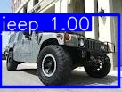

# 车辆检测系统 · SWJTU-AI-yolov5-cardetection

> **项目状态：已归档，不再维护（2026-11）**
> 本仓库**只保留代码、配置模板与文档**；模型权重、数据集、检测结果等运行态文件已全部移除。
> 在全新机器上按 [docs/SETUP.md](docs/SETUP.md) 可从零恢复运行；
> 历史数据与旧权重的线索见 [docs/ARCHIVE.md](docs/ARCHIVE.md)。

基于 YOLOv5 的车辆类型检测项目，支持图片 / 视频检测、自定义数据集训练，以及 Flask Web 可视化界面。
默认识别 6 类：`bus / car / motorbike / threewheel / truck / van`。



## 环境要求

| 项目 | 要求 |
| --- | --- |
| Python | **3.9 或 3.10**（vendor 版 YOLOv5 依赖 `pkg_resources`，3.12+ 不可用） |
| PyTorch | GPU 可选；CPU 也能跑推理（速度较慢） |
| FFmpeg | 仅 Web 端视频转码需要，需加入 PATH |
| 磁盘 | 运行态数据需自行准备，仓库本体约 3 MB（不含 vendor） |

## 快速开始

```bash
# 1. 建虚拟环境并装依赖
python -m venv .venv
.venv\Scripts\activate            # Linux/macOS: source .venv/bin/activate
pip install -r requirements.txt

# 2. 生成配置并预检
copy .env.example .env            # Linux/macOS: cp .env.example .env
copy configs\data.example.yaml configs\data.yaml
python scripts/check_env.py

# 3. 准备数据与权重后运行
python scripts/download_pretrained.py   # 下载官方 yolov5s.pt
python train.py                          # 训练（可选，也可直接用已有权重）
python test.py input/demo.jpg            # 本地 CLI 检测
python cloudtest.py                      # Web 端：http://127.0.0.1:5000/
```

完整步骤、常见报错与验证方法见 **[docs/SETUP.md](docs/SETUP.md)**。

## 三个入口

| 命令 | 作用 | 关键配置 |
| --- | --- | --- |
| `python train.py` | 训练，权重输出到 `runs/train/exp/weights/best.pt` | `CARDET_DATA_YAML`、`CARDET_PRETRAINED` |
| `python test.py [文件] [--no-gui]` | 本地图片 / 视频检测，支持无桌面环境 | `CARDET_WEIGHTS`、`CARDET_DEVICE` |
| `python cloudtest.py` | Flask Web 上传检测 | `CARDET_SECRET_KEY`、`CARDET_DEBUG`、`CARDET_PORT` |

所有配置集中在 `.env`（模板 [.env.example](.env.example)），字段含义见 [config.py](config.py)。

## 目录结构

```
CarDetection/
├── config.py                 # 统一配置（路径 / 阈值 / 设备 / Web 参数），零第三方依赖
├── detector.py               # 推理层：模型加载、letterbox 预处理、NMS、画框
├── train.py                  # 训练入口
├── test.py                   # 本地 CLI / GUI 检测入口
├── cloudtest.py              # Flask Web 入口
├── requirements.txt          # 依赖（含版本约束原因）
├── .env.example              # 运行配置模板
├── configs/                  # 数据集配置模板
├── scripts/                  # 环境预检、预训练权重下载
├── docs/                     # 全部文档
│   ├── SETUP.md              # 从零跑起来
│   ├── DATASET.md            # 数据集说明与重建方法
│   ├── ARCHITECTURE.md       # 架构、调整记录与已知限制
│   ├── ARCHIVE.md            # 归档清理清单与恢复指引
│   └── images/               # 文档用示例图
├── experiments/              # 历史实验脚本（仅供参考，不保证可运行）
├── static/ · templates/      # Web 前端资源
├── yolov5/                   # 随仓库附带的 YOLOv5 上游源码（AGPL-3.0）
├── input/ · output/          # 运行态目录（内容不入库，程序自动创建）
└── models/ · runs/ · data/   # 运行态目录（内容不入库）
```

## 文档索引

| 文档 | 内容 |
| --- | --- |
| [docs/SETUP.md](docs/SETUP.md) | 全新环境安装、数据准备、训练、推理、验证与排错 |
| [docs/DATASET.md](docs/DATASET.md) | 数据来源 / 许可 / 类别 / 目录结构 / 重建步骤 |
| [docs/ARCHITECTURE.md](docs/ARCHITECTURE.md) | 分层设计、本次重构改动清单、技术债与安全说明 |
| [docs/ARCHIVE.md](docs/ARCHIVE.md) | 清掉了什么、为什么、如何找回 |
| [THIRD_PARTY_NOTICES.md](THIRD_PARTY_NOTICES.md) | 第三方代码与数据集许可说明 |

## 许可与致谢

- 项目代码与文档供学习参考；`yolov5/` 为 Ultralytics 上游源码，遵守 **AGPL-3.0**，详见 [THIRD_PARTY_NOTICES.md](THIRD_PARTY_NOTICES.md)。
- 历史数据集来自 Roboflow 用户公开的 CarTypes（CC BY 4.0），本仓库**不分发**该数据。
- 感谢 [Ultralytics YOLOv5](https://github.com/ultralytics/yolov5) 及开源社区。
