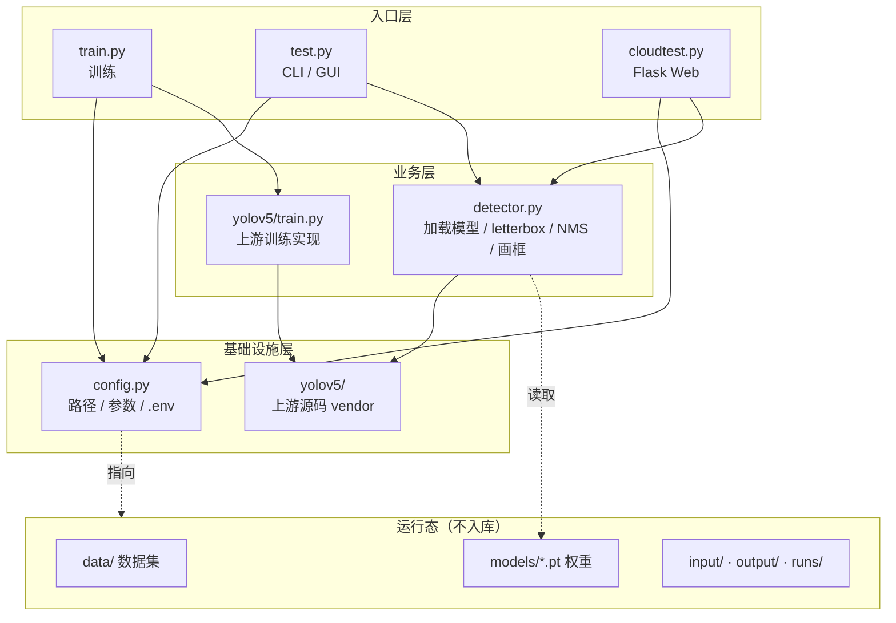

# 架构设计与本次调整记录（ARCHITECTURE）

## 1. 现状定位

这是一个**课程实验型单体项目**，不是服务化系统：单机、单进程、本地文件作为输入输出。
归档阶段的目标不是引入新框架，而是让它**可复现、可移植、可读** —— 换一台机器、
隔几年再 clone，仍然能按文档跑起来。因此本次调整以「消除隐式依赖」为主，
刻意不引入 Docker / 数据库 / 任务队列等额外组件。

## 2. 分层结构



| 层 | 文件 | 职责 |
| --- | --- | --- |
| 入口层 | `train.py` / `test.py` / `cloudtest.py` | 参数解析、UI、文件读写、流程编排；不含推理算法 |
| 推理层 | `detector.py` | 模型加载与缓存、letterbox 预处理、NMS、坐标还原、标注 |
| 基础设施 | `config.py` | 统一路径与参数，零第三方依赖，供预检脚本复用 |
| 上游 | `yolov5/` | 随仓库附带的 YOLOv5 源码，提供模型定义与训练实现 |
| 工具 | `scripts/` | 环境预检、预训练权重下载（只用标准库） |

## 3. 本次调整清单

| # | 归档前的问题 | 处理 | 收益 |
| --- | --- | --- | --- |
| 1 | `train.py` 里 `os.chdir('C:/CodeProjects/CarDetection')`，路径指向另一台机器的目录 | 改为 `config.ROOT = Path(__file__).resolve().parent` | 换机器、换盘符不再直接崩溃 |
| 2 | 权重 / 数据集 / 设备 / 阈值散落在 3 个脚本里硬编码（`models/exp4.pt`、`'0'`、`0.25` 等） | 抽到 `config.py` + `.env`，支持环境变量覆盖 | 一处修改、三端生效；CI / 生产可覆盖 |
| 3 | 三套导入风格（`yolov5.utils.*`、`utils.*`、`from yolov5 import train`），依赖隐式 `sys.path` | `config.setup_yolov5_path()` 统一置入 `yolov5/`，其余统一顶层导入 | 消除 `No module named 'utils'` 类问题 |
| 4 | `test.py` 与 `cloudtest.py` 各写一遍预处理 / NMS / 画框，约 60 行重复 | 抽为 `detector.py`，两入口共用 `detect_frame` | 行为一致，修复逻辑漂移 |
| 5 | CLI 版把图片直接 `resize(640,640)` 拉伸，检测框坐标与画框不一致 | 统一为等比缩放 + 灰边 letterbox，并正确回扣 padding | 检测框位置准确 |
| 6 | 视频推理未关闭梯度 | `torch.no_grad()` | 避免逐帧推理显存持续增长 |
| 7 | `train.run(save_dir='models/exp4.pt')` 无效；`img_size=640` 参数名错误 | 改为 `project` / `name` / `imgsz`，并在结束后打印真实权重路径 | 不再误以为权重没生成 |
| 8 | `select_device('0')` 强制 GPU | 支持 `CARDET_DEVICE`，默认自动 CUDA/CPU | 无显卡机器可跑 |
| 9 | Flask `secret_key='your_secret_key'`、`debug=True`、文件名未做安全处理 | 密钥来自环境变量 / 随机生成，debug 默认关，`secure_filename` | 消除路径穿越与调试模式暴露 |
| 10 | 模型全局加载无锁、ffmpeg 失败无提示且不清理临时文件 | 加锁缓存、捕获 stderr、`finally` 清理 | Web 并发与排障更可靠 |
| 11 | 根目录无依赖清单，只有上游 `yolov5/requirements.txt`（全是 `>=`） | 新增带版本上界与原因注释的 `requirements.txt` | 避免新版 numpy / setuptools 直接打断运行 |
| 12 | 无环境自检，缺文件只能看堆栈 | `scripts/check_env.py`（标准库实现） | 30 秒内定位缺什么 |
| 13 | 12 个冗余历史文件（`*old*`、带分号的 js、zip、pyc、`.idea`） | 清理并归档历史脚本到 `experiments/` | 仓库只剩有效内容 |

## 4. 技术选型对比（为什么这么做）

### YOLOv5 源码如何随项目保存

| 方案 | 优点 | 缺点 | 结论 |
| --- | --- | --- | --- |
| **vendor 到 `yolov5/`（采用）** | clone 即用、版本完全锁定、离线可跑 | 仓库含第三方代码，需遵守 AGPL-3.0；不自动获得上游修复 | 归档项目优先「可复现」 |
| Git submodule | 仓库干净、上游可追溯 | clone 必须 `--recursive`，容易漏拉； pinned commit 失效后无法离线 | 增加恢复门槛 |
| 改用新版 `ultralytics` pip 包 | 维护活跃、API 现代 | API 与权重格式差异大，三个入口几乎要重写；老权重可能不兼容 | 与「不再维护」目标冲突 |

### 配置方式

| 方案 | 结论 |
| --- | --- |
| 硬编码在脚本里 | 已废弃，换机器即坏 |
| **config.py + .env + 环境变量覆盖（采用）** | 三入口共享、零第三方依赖、CI 可直接覆盖 |
| 纯 CLI 参数 | Web 端无法用；训练参数太多，命令会很长 |
| 引入 pydantic-settings / dynaconf | 为归档项目增加依赖，收益不抵成本 |

## 5. 已知限制与技术债（保留，不再修复）

- **训练/推理预处理不完全一致**：历史数据集图片被拉伸到 640×640，推理用 letterbox；
  精度有轻微损失，需重新训练才能彻底消除（[DATASET.md](DATASET.md) 第 6 节）。
- **`yolov5/` 是旧版上游**：`general.py` / `common.py` 会在缺少 `ultralytics` 时
  触发 `pip install -U`，只能靠预装依赖规避；AGPL-3.0 许可也随代码带入。
- **Web 端是同步阻塞处理**：大视频会占住一个 worker，且 `input/` / `output/`
  不做清理、不做用户隔离，仅适合本机 / 内网演示。
- **视频转码多一次磁盘 I/O**：OpenCV 写 mp4v 临时文件 → ffmpeg 转 H.264。
- **无自动化测试**：本次仅做静态语法检查与零依赖预检脚本验证；
  完整训练 / 推理未在归档环境实跑（当前环境 Python 3.13 且未安装 torch / flask）。
- **`experiments/` 里的历史脚本**：保留作演进记录，含过期路径与旧 API，不保证可运行。

## 6. 安全与部署边界

| 场景 | 建议 |
| --- | --- |
| 本地开发 | `CARDET_DEBUG=1` 可用，监听 `127.0.0.1`，权重与数据放本地 |
| 内网演示 | `CARDET_DEBUG=0`、显式 `CARDET_SECRET_KEY`、限制上传体积、定期清理 `input/` `output/` |
| 公网生产 | **不建议直接用本项目**；若必须，请套 WSGI + Nginx、加认证与限流、隔离上传目录、把权重放对象存储 |

## 7. 如何验证本次重构

```bash
python -m compileall -q config.py detector.py train.py test.py cloudtest.py scripts/
python scripts/check_env.py
```

`check_env.py` 只依赖标准库，可在任何 Python 3.8+ 环境运行；
完整依赖验证按 [SETUP.md](SETUP.md) 第 9 节的清单执行。
